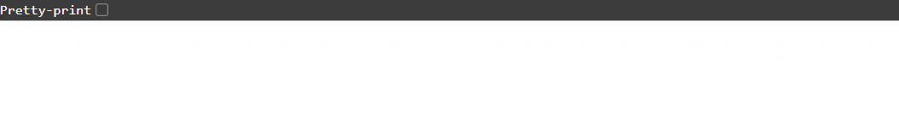
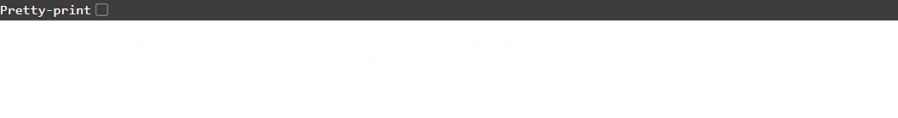
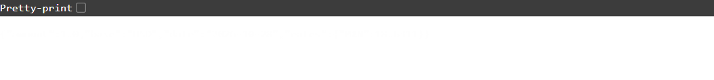
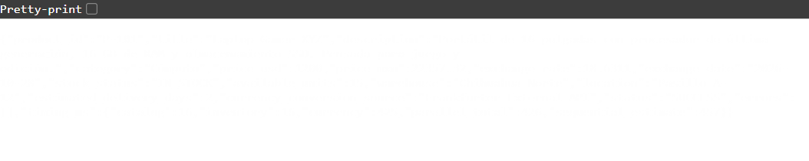
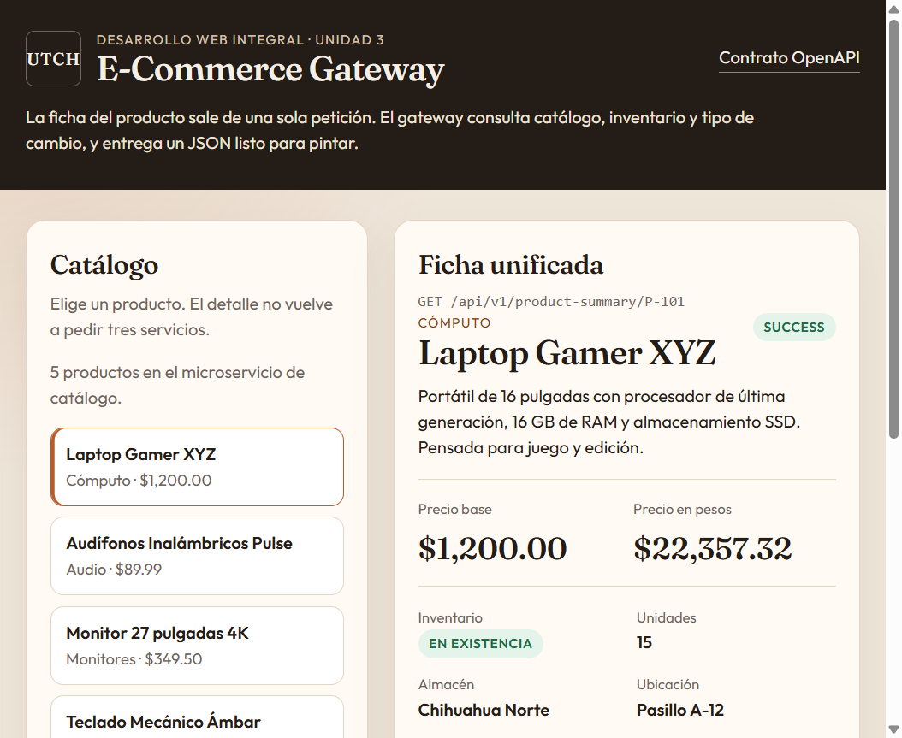
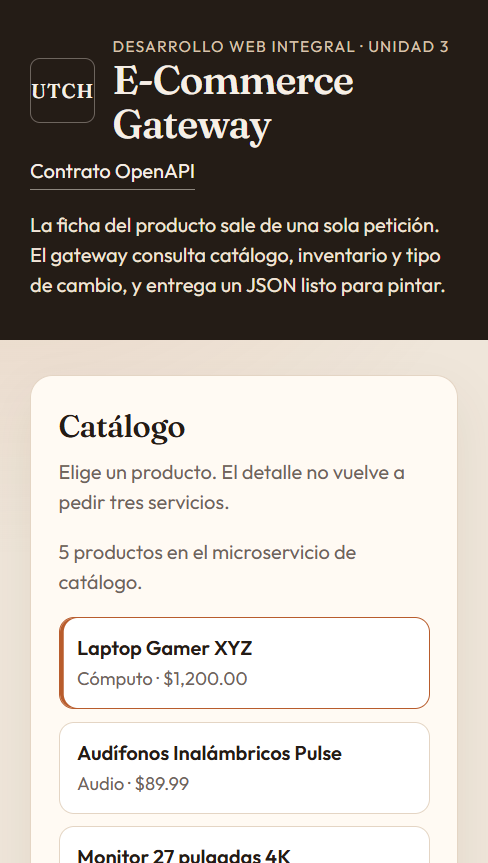
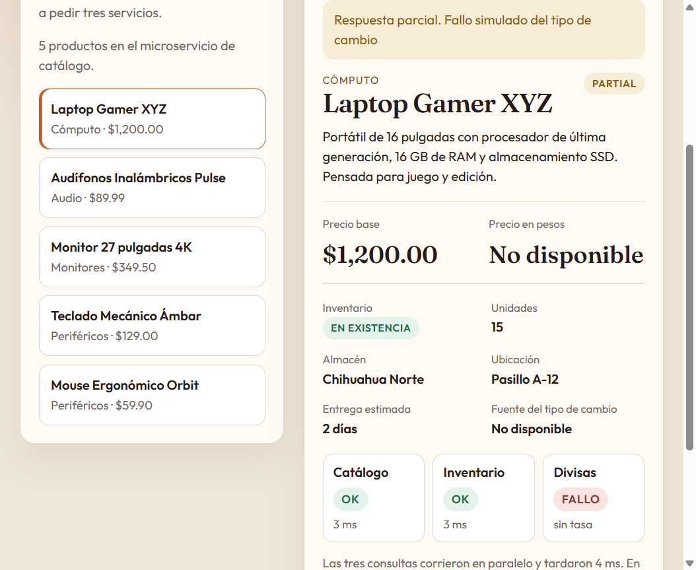

# Reporte de las APIs utilizadas y cómo se implementaron

## 1. Portada institucional

| Dato | Contenido |
| --- | --- |
| Universidad | Universidad Tecnológica de Chihuahua (UTCH) |
| Programa educativo | Desarrollo y Gestión de Software |
| Asignatura | Desarrollo Web Integral — Unidad 3 |
| Práctica | Implementación de Composite API y consumo de microservicios |
| Alumno | Mauricio De los Ríos López |
| Modalidad | Individual |
| Grupo | Completar antes de entregar |
| Fecha de entrega | 28 de octubre de 2026 |

## 2. Introducción y caso de estudio

La pantalla de detalle de un producto, en la tienda de esta práctica, necesita tres datos que no viven en el mismo lugar: la ficha comercial, la existencia en almacén y el precio en pesos. Si el navegador pide cada dato por su cuenta, hace tres viajes de ida y vuelta. Ese patrón se conoce como *chatty I/O*: el cliente habla demasiado con la red. En un teléfono, con latencia alta o con una señal irregular, la pantalla espera a la suma de esas tres respuestas y además queda acoplada a contratos internos que no fueron pensados para ella.

La solución es una **API compuesta** (también llamada *API Aggregator* o *Backend for Frontend*). El navegador hace una sola petición:

`GET /api/v1/product-summary/{id}`

El gateway, del lado del servidor, consulta al mismo tiempo el catálogo, el inventario y el tipo de cambio. Después transforma esas tres respuestas al contrato que la interfaz necesita. El cliente deja de conocer las URL internas y deja de sumar latencias.

Ventajas frente a las peticiones directas desde el navegador:

- Una sola espera de red entre el usuario y el sistema.
- Las tres consultas internas corren en paralelo, así que el tiempo total se acerca al del servicio más lento, no a la suma de los tres.
- El contrato de salida es el de la pantalla: nombre, precio en USD, precio en MXN, stock y estado. El frontend no rearma el JSON.
- Un fallo de la divisa o del almacén no borra la ficha del producto. La respuesta puede ser parcial.
- La API externa queda en el servidor. El navegador no depende de CORS ni de la forma en que Frankfurter cambie su payload.

## 3. Especificación técnica de las APIs y microservicios

Los dos microservicios propios y el gateway comparten el mismo repositorio para poder levantar la práctica con `npm start`, pero cada uno escucha en su puerto y solo se hablan por HTTP.

| Microservicio / API | Tipo | Protocolo / formato | Endpoint / URL base | Descripción y función |
| --- | --- | --- | --- | --- |
| 1. Catálogo | Propia | REST / JSON | `http://127.0.0.1:3001/microservices/products/{id}` | Nombre, descripción, categoría y precio base en USD. |
| 2. Inventario | Propia | REST / JSON | `http://127.0.0.1:3002/microservices/inventory/{id}` | Unidades, estado de stock, almacén, pasillo y días estimados de entrega. |
| 3. Divisas | Terceros (Frankfurter) | REST / JSON | `https://api.frankfurter.app/latest?from=USD&to=MXN` | Tasa USD/MXN del día. Si no responde, se usa ExchangeRate-API como respaldo. |
| 4. Composite API | Propia (agregadora) | REST / JSON | `http://127.0.0.1:3000/api/v1/product-summary/{id}` | Orquesta las tres peticiones y entrega un solo JSON. |

El listado del catálogo también pasa por el gateway (`GET /api/v1/products`) para que el tablero no tenga que llamar al puerto 3001. El detalle del producto, que es el caso de la práctica, sale únicamente de la compuesta.

Estados de inventario que calcula el microservicio de almacén:

| Unidades | `stock_status` |
| --- | --- |
| 0 | `OUT_OF_STOCK` |
| 1 a 5 | `LOW_STOCK` |
| 6 o más | `IN_STOCK` |

Estados de la compuesta:

| `status` | Cuándo ocurre | HTTP |
| --- | --- | --- |
| `SUCCESS` | Catálogo, inventario y divisa respondieron. | 200 |
| `PARTIAL` | El producto existe, pero inventario o divisa fallaron. | 200 |
| `ERROR` | El catálogo no tiene el producto o no respondió. | 404 o 502 |

## 4. Detalles de la implementación, código y orquestación

### 4.1 Estrategia de consumo: en paralelo

Las tres llamadas se disparan juntas con `Promise.all`. Cada pierna va envuelta en `runLeg`, que captura su propio error. Gracias a eso, si Frankfurter falla, el catálogo y el inventario no se cancelan.

```javascript
const [catalog, inventory, currency] = await Promise.all([
  runLeg(
    "catalog",
    () => fetchImpl(`${productsBaseUrl}/microservices/products/${encodeURIComponent(productId)}`),
    simulatedFailure
  ),
  runLeg(
    "inventory",
    () => fetchImpl(`${inventoryBaseUrl}/microservices/inventory/${encodeURIComponent(productId)}`),
    simulatedFailure
  ),
  runLeg("currency", () => getExchangeRate(), simulatedFailure),
]);
```

Archivo: `server/composite.js`.

No es una secuencia `await` tras `await`. El reloj de pared (`parallel_total`) queda cerca de la pierna más lenta. `sequential_estimate` suma las tres duraciones y sirve para comparar qué habría pasado si se hubieran pedido una después de otra. En una captura del 28 de octubre de 2026, con la tasa aún sin caché, el catálogo tardó 16 ms, el inventario 16 ms y Frankfurter 425 ms. El total en paralelo fue 426 ms. En secuencia habrían sido cerca de 457 ms. La diferencia crece cuando los tres servicios remotos son lentos a la vez: la espera del cliente es la del más lento, no la suma.

### 4.2 Cliente HTTP de la API externa

El cliente usa `fetch` de Node.js. Manda `Accept: application/json` y corta la espera con `AbortSignal.timeout`. Un timeout o un HTTP de error se convierten en una excepción con código, para que la compuesta no tenga que interpretar cada fallo de red.

```javascript
async function fetchJson(url, { timeoutMs = 4000 } = {}) {
  let response;
  try {
    response = await fetch(url, {
      headers: { Accept: "application/json" },
      signal: AbortSignal.timeout(timeoutMs),
    });
  } catch (error) {
    const timedOut = error.name === "TimeoutError" || error.name === "AbortError";
    const wrapped = new Error(
      timedOut
        ? "Tiempo de espera agotado al consultar el servicio"
        : "No hubo respuesta del servicio"
    );
    wrapped.code = timedOut ? "TIMEOUT" : "NETWORK";
    wrapped.cause = error;
    throw wrapped;
  }
  // ... lee el JSON y rechaza si el estado HTTP no es exitoso
}
```

Archivo: `server/lib/http.js`.

Frankfurter se consulta en la URL del planteamiento. Hoy ese host responde `301` y envía el cliente a `https://api.frankfurter.dev/v1/latest?from=USD&to=MXN`. `fetch` sigue la redirección, así que el código no depende de memorizar el host nuevo. La tasa vigente el 28 de octubre de 2026 fue **18.6311 MXN por 1 USD**.

```javascript
const FRANKFURTER_URL = "https://api.frankfurter.app/latest?from=USD&to=MXN";

try {
  const payload = await fetchImpl(FRANKFURTER_URL, { timeoutMs: 5000 });
  const value = readFrankfurter(payload);
  cache = { storedAt: now(), value };
  return { ...value, cached: false };
} catch (error) {
  primaryError = error;
}
```

Archivo: `server/currency-client.js`.

`readFrankfurter` solo acepta la respuesta si `rates.MXN` es un número mayor que cero. El nombre que viaja en el contrato es exactamente `Frankfurter External API`.

La tasa no cambia por producto, así que se guarda 60 segundos en memoria. Eso evita pegarle a un servicio público cada vez que el usuario cambia de ficha.

### 4.3 Mapeo hacia el contrato final

Frankfurter no conoce el producto. Solo entrega la tasa. El precio en pesos se calcula en el gateway:

`price_mxn = redondeo a 2 decimales (price_usd × rates.MXN)`

```javascript
if (currency.ok) {
  exchangeRate = currency.value.rate;
  exchangeDate = currency.value.date;
  currencySource = currency.value.source;
  priceMxn = roundMoney(product.price_usd * exchangeRate);
}
```

Con la tasa de ejemplo del planteamiento (17), 1200 USD producen 20400 MXN. Esa cuenta está cubierta por `npm test` sin salir a internet. Con la tasa real del 28 de octubre:

`1200 × 18.6311 = 22357.32`

Ese es el `price_mxn` que devolvió la compuesta para `P-101`.

El resto del mapeo es directo:

| Campo final | Origen |
| --- | --- |
| `product_id`, `title`, `description`, `category`, `price_usd` | Catálogo |
| `stock_status`, `available_units`, `warehouse`, `location`, `estimated_delivery_days` | Inventario |
| `price_mxn`, `exchange_rate`, `exchange_date`, `currency_conversion_source` | Tasa externa aplicada al precio USD |

### 4.4 Tolerancia a fallos

Cada pierna tiene su propio `try/catch`. El error no se relanza: se regresa como resultado `{ ok: false }`. `Promise.all` siempre termina y el gateway decide qué puede publicar.

```javascript
async function runLeg(name, task, fail) {
  const startedAt = performance.now();
  try {
    if (fail === name) {
      throw Object.assign(new Error(FAILURE_MESSAGES[name]), { code: "SIMULATED_FAILURE" });
    }
    const value = await task();
    return { name, ok: true, value, ms: elapsedMs(startedAt) };
  } catch (error) {
    return { name, ok: false, error, ms: elapsedMs(startedAt) };
  }
}
```

Reglas:

- Si el catálogo responde 404, la compuesta responde 404 con `status: "ERROR"` y `error_code: "PRODUCT_NOT_FOUND"`. No se inventa un precio.
- Si el catálogo no contesta, la respuesta es 502. Sin ficha no hay detalle que mostrar.
- Si el inventario falla y el producto sí existe, `stock_status` queda en `UNKNOWN`, las unidades en `null` y `status` en `PARTIAL`. El precio sí se muestra.
- Si la divisa falla, `price_mxn` queda en `null` y el origen de la conversión también. El nombre, el precio en dólares y el stock siguen en la respuesta.
- Antes de darse por vencida, la divisa intenta ExchangeRate-API (`https://open.er-api.com/v6/latest/USD`). Solo si las dos fallan, el precio en pesos se omite. En ese caso `currency_conversion_source` sería `ExchangeRate-API (respaldo)`.
- La ruta del gateway tiene otro `try/catch`. Un error que nadie esperaba responde 500 con `status: "ERROR"` y no tira el proceso.

Para la clase, en desarrollo se puede tumbar una sola pierna sin apagar el proceso:

```text
GET /api/v1/product-summary/P-101?fail=currency
GET /api/v1/product-summary/P-101?fail=inventory
```

Con `NODE_ENV=production` ese parámetro se ignora.

## 5. Evidencias de funcionamiento

Servidor local, 28 de octubre de 2026. La colección para repetir las mismas llamadas está en `postman/E-Commerce-Composite-API.postman_collection.json`. El contrato también se puede ejecutar desde `http://127.0.0.1:3000/docs.html`.

### 5.1 Microservicio 1 — Catálogo

`GET http://127.0.0.1:3001/microservices/products/P-101`



### 5.2 Microservicio 2 — Inventario

`GET http://127.0.0.1:3002/microservices/inventory/P-101`



Quince unidades producen `stock_status: "IN_STOCK"`. El monitor `P-103` regresa `OUT_OF_STOCK` con 0 unidades. Los audífonos `P-102` regresan `LOW_STOCK` con 4 unidades.

### 5.3 API externa — Frankfurter

`GET https://api.frankfurter.app/latest?from=USD&to=MXN`

El navegador siguió el 301 y terminó en `api.frankfurter.dev`. La tasa del día fue 18.6311.



### 5.4 Composite API — respuesta unificada

`GET http://127.0.0.1:3000/api/v1/product-summary/P-101`



Contrato consolidado de esa llamada:

```json
{
  "product_id": "P-101",
  "title": "Laptop Gamer XYZ",
  "price_usd": 1200,
  "price_mxn": 22357.32,
  "exchange_rate": 18.6311,
  "exchange_date": "2026-10-28",
  "stock_status": "IN_STOCK",
  "available_units": 15,
  "currency_conversion_source": "Frankfurter External API",
  "status": "SUCCESS",
  "errors": [],
  "timing_ms": {
    "catalog": 16,
    "inventory": 16,
    "currency": 425,
    "parallel_total": 426,
    "sequential_estimate": 457
  }
}
```

La respuesta también incluye descripción, categoría, almacén y ubicación. Esos campos alimentan la ficha y no sustituyen los ocho campos pedidos en el planteamiento.

### 5.5 Tablero

El navegador pide el resumen una sola vez. La línea bajo el título muestra la URL real: `GET /api/v1/product-summary/P-101`.



En un ancho menor a 720 px el catálogo y la ficha se apilan. El texto y los precios siguen dentro de la columna.



### 5.6 Fallo de la divisa sin perder el producto

`GET /api/v1/product-summary/P-101?fail=currency` responde 200 con `status: "PARTIAL"`. El precio en dólares y las 15 unidades siguen visibles. El precio en pesos queda en "No disponible".



```json
{
  "product_id": "P-101",
  "title": "Laptop Gamer XYZ",
  "price_usd": 1200,
  "price_mxn": null,
  "stock_status": "IN_STOCK",
  "available_units": 15,
  "currency_conversion_source": null,
  "status": "PARTIAL",
  "errors": [
    {
      "service": "currency",
      "code": "SIMULATED_FAILURE",
      "message": "Fallo simulado del tipo de cambio"
    }
  ]
}
```

Un id que no existe, `P-999`, responde **404**:

```json
{
  "product_id": "P-999",
  "status": "ERROR",
  "error_code": "PRODUCT_NOT_FOUND",
  "message": "No existe el producto P-999"
}
```

`npm test` cubre el contrato de 20400 MXN, la respuesta parcial, el producto inexistente, el fallo simulado de inventario y el salto al servicio de respaldo. Esas pruebas no llaman a internet: inyectan las tres respuestas.

## 6. Conclusiones y lecciones aprendidas

Integrar una API de terceros con dos servicios propios obliga a tratar la respuesta externa como datos inestables. Frankfurter puede tardar, cambiar de host o venir sin la tasa. Por eso la conversión no se hace en el navegador y el precio en pesos puede faltar sin que desaparezca el producto. El respaldo con ExchangeRate-API cubre la caída del proveedor principal; el `PARTIAL` cubre la caída de los dos.

La API agregadora conviene en una aplicación web moderna porque la pantalla deja de estar amarrada al mapa interno de servicios. Si mañana el inventario cambia de puerto o la tasa llega de otro proveedor, se toca el gateway y el contrato que ya consume la interfaz se mantiene. El usuario percibe una ficha completa con un solo request, y el tiempo de espera lo marca el servicio más lento, no la cola de tres peticiones.

La lección práctica más clara: paralelizar no basta si un rechazo tumba a las otras promesas. `Promise.all` junto con un `try/catch` por pierna permite publicar lo que sí llegó y decir, en el mismo JSON, qué servicio faltó.

## 7. Enlace al repositorio

https://github.com/Mauricio1011/Reporte-de-las-APIS-utilizadas-y-c-mo-se-implementaron

Instrucciones de ejecución: [README.md](README.md).

```bash
npm install
npm start
```

Tablero: http://127.0.0.1:3000

Flujo de ramas previsto:

```text
main
└── develop
    └── feature/composite-api
```

## 8. Lista de cotejo (autoevaluación)

La columna oficial la llena quien evalúa. Esta fila deja la evidencia localizada.

| Criterio | Cumple | Puntos | Observaciones |
| --- | --- | --- | --- |
| 1. Identificación y descripción de las 3 APIs | Sí | 20% | Sección 3. Propósito, parámetros (`id`) y respuestas de catálogo, inventario y Frankfurter. |
| 2. Consumo de la API externa y conversión | Sí | 20% | Sección 4.2 y 4.3. Tasa 18.6311 y precio 22357.32 MXN. Respaldo con ExchangeRate-API. |
| 3. Orquestación / Composite API | Sí | 25% | `Promise.all` en `server/composite.js`. Un solo JSON con los campos pedidos. |
| 4. Manejo de errores / resiliencia | Sí | 15% | `try/catch` por pierna, timeout, 404, `PARTIAL` y simulación `?fail=`. |
| 5. Evidencias y repositorio | Sí | 20% | Sección 5, carpeta `evidencias/` y colección de Postman. El enlace remoto queda publicado al subir los commits. |
